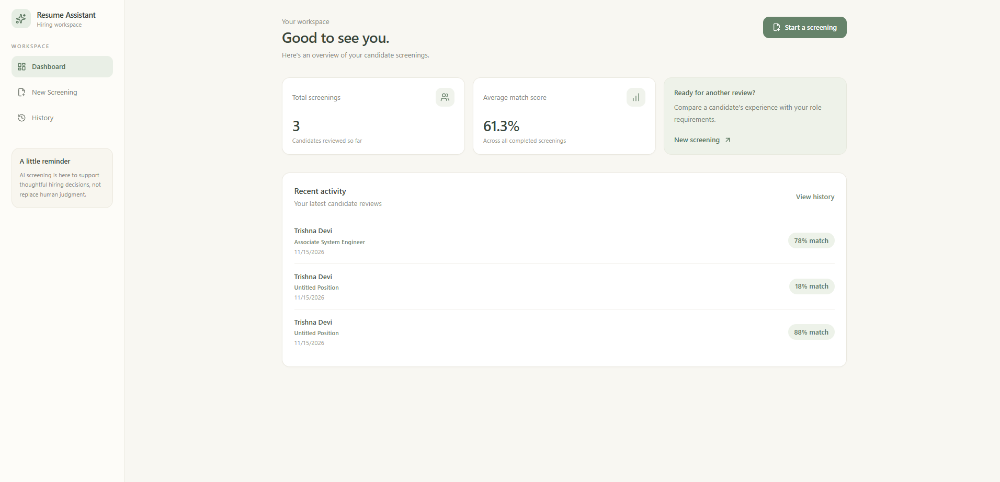
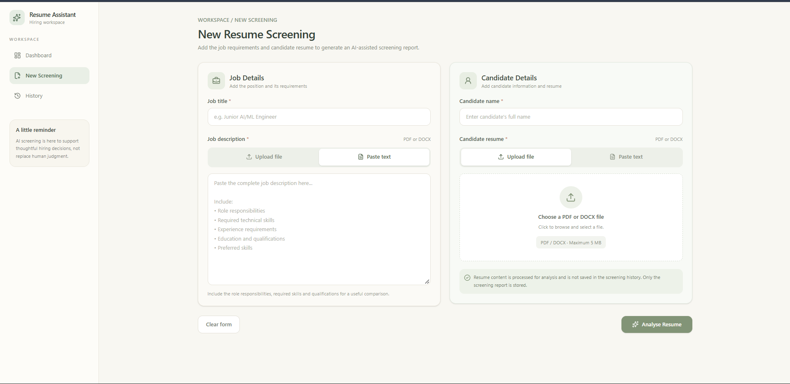
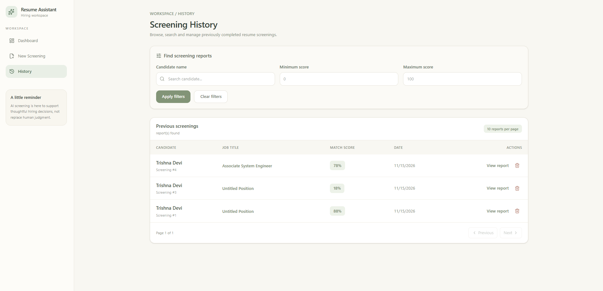
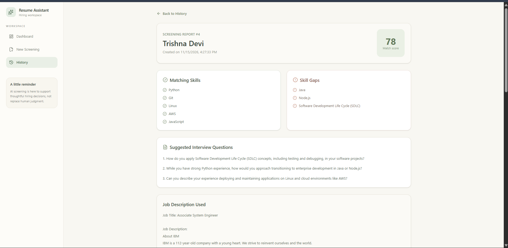

# Resume Screener Assistant

An AI-powered internal HR tool that evaluates how well a candidate's resume matches a job description. It generates a structured screening report with a match score, matching skills, skill gaps, and suggested interview questions.

## Features

- Enter a job title and job description using pasted text or PDF/DOCX upload.
- Enter a candidate name and resume using pasted text or PDF/DOCX upload.
- Generate an AI-powered candidate match report.
- Display a match score from 0–100.
- Identify up to 5 matching skills and up to 3 skill gaps.
- Generate exactly 3 suggested interview questions.
- Save screening reports in SQLite.
- View screening history with candidate-name search and score-range filters.
- View individual screening reports.
- Delete saved screening records.
- Dashboard with screening statistics and recent activity.

## Technology Stack

### Frontend
- React.js
- Vite
- Tailwind CSS
- React Router
- Lucide React

### Backend
- Python
- Flask
- Flask-SQLAlchemy
- Pydantic
- Google Gemini API

### Database and Document Processing
- SQLite
- SQLAlchemy
- PyMuPDF for PDF extraction
- python-docx for DOCX extraction

## Project Structure

```text
resume-screener-assistant/
├── backend/
│   ├── app/
│   │   ├── models/
│   │   ├── routes/
│   │   ├── schemas/
│   │   ├── services/
│   │   └── utils/
│   ├── instance/
│   ├── config.py
│   ├── requirements.txt
│   └── run.py
├── frontend/
│   └── src/
│       ├── components/
│       ├── pages/
│       ├── services/
│       └── App.jsx
├── docs/
├── AI_USAGE.md
├── README.md
└── .gitignore
```

## Getting Started

### Prerequisites

- Python 3.10 or later
- Node.js and npm
- Google Gemini API key

### 1. Clone the repository

```powershell
git clone https://github.com/trishnadevii/resume-screener-assistant.git
cd resume-screener-assistant
```

### 2. Set up the backend

```powershell
cd backend
python -m venv .venv
.venv\Scripts\Activate.ps1
pip install -r requirements.txt
```

Create a `.env` file inside the `backend` directory:

```env
GEMINI_API_KEY=your_gemini_api_key
GEMINI_MODEL=gemini-2.5-flash
```

Keep the API key private. Do not commit the `.env` file.

Start the backend:

```powershell
python run.py
```

The backend runs at:

`http://127.0.0.1:5000`

Health check:

`http://127.0.0.1:5000/api/health`

### 3. Set up the frontend

Open another terminal:

```powershell
cd frontend
npm install
npm run dev
```

Open the local Vite URL, normally:

`http://localhost:5173`

## API Endpoints

| Method | Endpoint | Purpose |
|---|---|---|
| GET | `/api/health` | Check API status |
| GET | `/api/dashboard` | Retrieve dashboard statistics |
| POST | `/api/analyze` | Analyze a candidate |
| GET | `/api/analyses` | List screening records |
| GET | `/api/analyses/:id` | Retrieve a screening report |
| DELETE | `/api/analyses/:id` | Delete a screening record |

The history endpoint supports candidate-name search, score-range filters, and pagination.

## Match Scoring

The analysis uses the following scoring dimensions:

| Dimension | Weight |
|---|---:|
| Required skills match | 40% |
| Relevant work experience | 30% |
| Education and certifications | 15% |
| Tools, technologies and domain knowledge | 15% |
| **Total** | **100%** |

The AI generates the match assessment. The backend validates the returned structure using Pydantic before saving or displaying the report.

## Data and Privacy

- Resume and job-description content is processed in memory for analysis.
- Original resume text and uploaded resume files are not stored in the database.
- Screening reports are saved in SQLite.
- The Gemini API key is kept in the backend environment configuration and is not exposed in frontend code.
- Screening reports contain candidate-related information and should be handled as confidential HR data.
- Access to the application should be restricted to authorized HR users.

## Design Decisions

- **Flask:** Provides a lightweight backend and clear API structure.
- **React:** Supports a responsive, component-based user interface.
- **SQLite:** Keeps local setup simple for this small internal application.
- **Pydantic:** Validates AI-generated output before it is used.
- **Service-based backend:** Separates document extraction, AI analysis, and screening persistence.
- **Report-only storage:** Avoids retaining original resume content after processing.

## Current Limitations

- Scanned PDFs without selectable text are not processed because OCR is not implemented.
- DOCX extraction currently focuses on paragraph text and may not extract content inside tables.
- The application is designed as an internal assessment prototype; production deployment would require authentication, access controls, and a formal data-retention policy.


## Application Screenshots

### 1. Dashboard
The dashboard provides an overview of screening activity, including summary statistics and recent candidate analyses.



### 2. New Screening
The New Screening page allows HR to enter job details and candidate information. Both job descriptions and resumes can be provided through pasted text or PDF/DOCX uploads.



### 3. Screening History
The History page displays previously saved screening reports. HR can search by candidate name, filter by match score, view reports, and delete records.



### 4. Detailed Screening Report
The detailed report displays the AI-generated match score, matching skills, skill gaps, and suggested interview questions for a candidate.




## Author

Trishna Devi 
Developed as part of the Synthweb AI Product Engineer candidate assessment.
