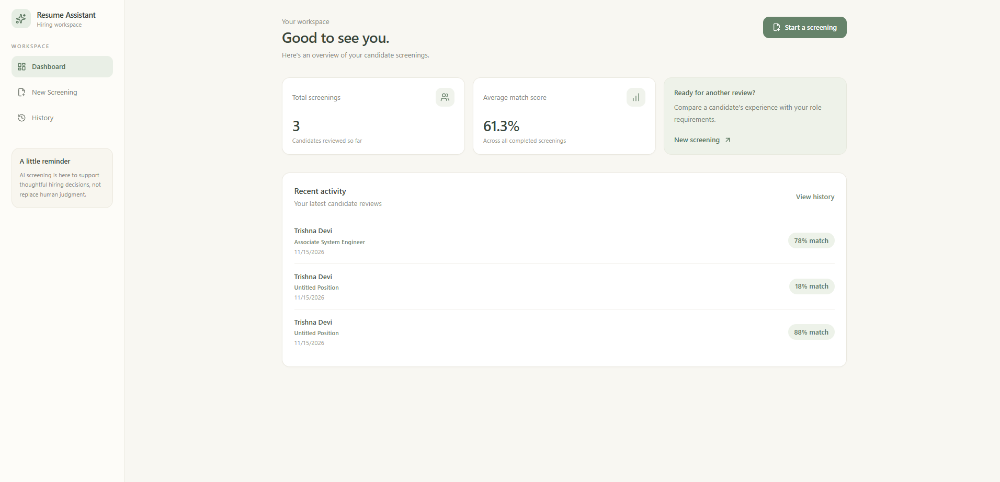
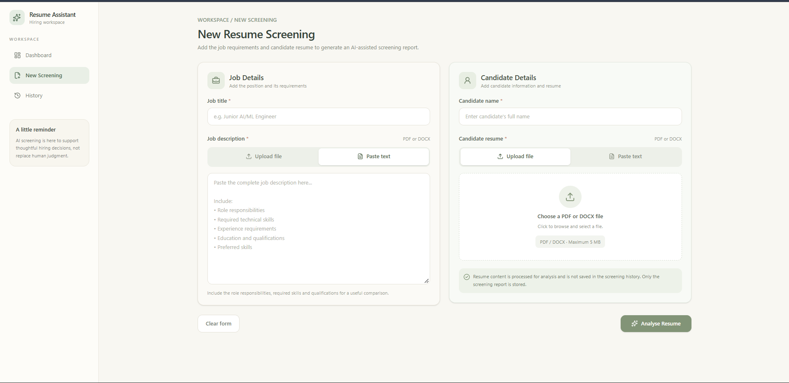
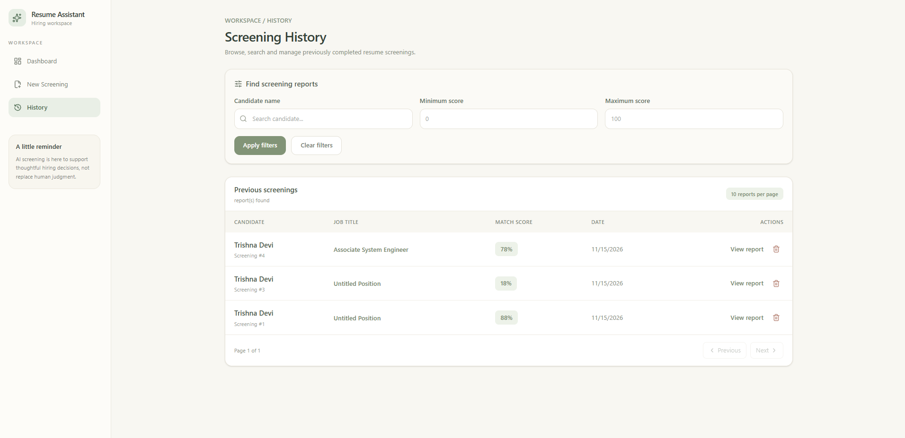
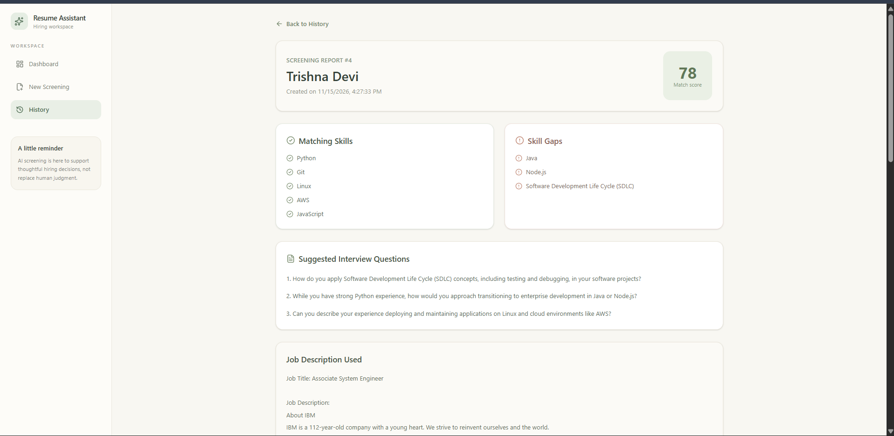

# Resume Screener Assistant
## Complete Project Documentation

**Project:** Resume Screener Assistant  
**Organization:** Synthweb  
**Project Type:** AI-powered HR Resume Screening Web Application  
**Status:** Application developed and tested locally; Railway deployment attempted  
**Repository:** https://github.com/trishnadevii/resume-screener-assistant

---

# 1. Project Overview

## 1.1 Introduction

Resume Screener Assistant is a web-based application designed to help HR teams evaluate candidate resumes against specific job descriptions.

The application uses an AI model to analyze the relevance of a candidate's skills, experience, education, and technical knowledge in relation to a job description.

It generates a structured screening report containing:

- Overall resume match score (0–100).
- Top five matching skills.
- Top three skill gaps.
- Three suggested interview questions.

The application also saves screening reports in a database, allowing HR users to review, search, filter, and delete previous analyses.

## 1.2 Problem Statement

HR teams may receive a large number of resumes for a single job opening. Manually comparing every resume against the job requirements can be time-consuming.

This application aims to simplify the initial screening process by using AI to generate consistent, structured assessments and by maintaining a searchable screening history.

## 1.3 Project Objectives

1. Provide an interface for entering job descriptions and uploading resumes.
2. Use an AI model to analyze candidate-job compatibility.
3. Generate structured and validated screening reports.
4. Store screening results in a database.
5. Provide a history page with search and filtering functionality.
6. Handle invalid inputs, API errors, malformed responses, and long documents.
7. Protect API credentials and minimize the storage of candidate personal information.

---

# 2. Technology Stack

The application uses a React frontend and a Python Flask backend.

| Component | Technology | Purpose |
|---|---|---|
| Frontend | React.js | User interface |
| Build tool | Vite | Frontend development and production builds |
| Styling | Tailwind CSS | Responsive UI styling |
| Navigation | React Router | Page navigation |
| Icons | Lucide React | Interface icons |
| Backend | Python Flask | REST API |
| AI integration | Google Gemini API | Resume analysis |
| AI SDK | google-genai | Communication with Gemini |
| Database | SQLite | Screening history storage |
| ORM | Flask-SQLAlchemy | Database operations |
| Validation | Pydantic | AI response validation |
| PDF processing | PyMuPDF | PDF text extraction |
| DOCX processing | python-docx | Word document text extraction |
| API communication | Fetch API | Frontend-backend communication |
| Cross-origin requests | Flask-CORS | CORS configuration |
| Environment configuration | python-dotenv | Local environment variables |
| Production server | Gunicorn | Flask application serving |

---

# 3. System Architecture

The application follows a frontend-backend architecture.

## 3.1 Architecture Overview

```text
                  USER / HR TEAM
                        |
                        |
                        v
              REACT FRONTEND (VITE)
                        |
             -----------------------
             |         |           |
             v         v           v
          Dashboard  Screening   History
                        |
                        |
                  Fetch API Calls
                        |
                        v
                FLASK BACKEND
                        |
           -------------------------
           |           |           |
           v           v           v
       API Routes   AI Service   Database
           |           |           |
           |           v           |
           |       Gemini API      |
           |           |           |
           |           v           |
           |    Structured JSON    |
           |           |           |
           |           v           |
           |     Pydantic          |
           |     Validation       |
           |           |           |
           ----------- | -----------
                       |
                       v
                SQLite Database
                       |
                       v
               Screening Report
                       |
                       v
                 React Frontend
```

## 3.2 How the Application Works

1. The HR user opens the application.
2. The user enters a job title and job description.
3. The user enters a candidate name and provides a resume as text or an uploaded PDF/DOCX file.
4. The frontend sends the information to the Flask backend.
5. The backend extracts resume text when a file is uploaded.
6. The AI service sends the job description and resume text to Google Gemini.
7. Gemini generates a structured JSON screening report.
8. Pydantic validates the response against the expected schema.
9. The backend saves the validated screening report to SQLite.
10. The frontend displays the screening result.
11. The HR user can later access the report through the History page.

---

# 4. Project Folder Structure

The project is organized into separate frontend, backend, documentation, and demonstration folders.

```text
resume-screener-assistant/
│
├── frontend/
│   ├── src/
│   │   ├── components/
│   │   │   ├── layout/
│   │   │   ├── dashboard/
│   │   │   ├── screening/
│   │   │   └── history/
│   │   │
│   │   ├── pages/
│   │   ├── services/
│   │   ├── hooks/
│   │   ├── utils/
│   │   ├── App.jsx
│   │   ├── main.jsx
│   │   └── index.css
│   │
│   └── package.json
│
├── backend/
│   ├── app/
│   │   ├── routes/
│   │   ├── services/
│   │   ├── models/
│   │   ├── schemas/
│   │   ├── utils/
│   │   ├── __init__.py
│   │   └── extensions.py
│   │
│   ├── instance/
│   ├── config.py
│   ├── run.py
│   └── requirements.txt
│
├── docs/
│   ├── technical-design.md
│   ├── PRD.md
│   └── PROJECT_DOCUMENTATION.md
│
├── demo/
│   ├── Dashboard_View.png
│   ├── NewScreening.png
│   ├── History.png
│   └── DetailedReport.png
│
├── .gitignore
├── README.md
└── AI_USAGE.md
```

### Folder responsibilities

**frontend/src/components/**

Contains reusable UI components organized by application functionality.

**frontend/src/pages/**

Contains the main application pages, such as Dashboard, New Screening, and History.

**frontend/src/services/**

Contains frontend API communication logic.

**backend/app/routes/**

Contains Flask API endpoints.

**backend/app/services/**

Contains business logic, including AI integration and resume processing.

**backend/app/models/**

Contains SQLAlchemy database models.

**backend/app/schemas/**

Contains Pydantic validation schemas.

**backend/app/utils/**

Contains reusable backend utility functions.

**docs/**

Contains project requirements, technical design, and detailed documentation.

**demo/**

Contains screenshots demonstrating the application's functionality.

---

# 5. Application Features

## 5.1 Dashboard

The Dashboard provides an overview of screening activity.

It helps HR users understand the application's screening activity and navigate to the main features.

## 5.2 New Resume Screening

The New Screening page accepts the information required for resume evaluation.

### Inputs

- Candidate name.
- Job title.
- Job description.
- Resume text or uploaded resume document.

### Supported resume formats

- PDF
- DOCX
- Plain text

The backend extracts text from uploaded documents before sending the content for AI analysis.

## 5.3 AI-Powered Resume Analysis

The application uses the Google Gemini API to evaluate the candidate's resume against the job description.

The AI is instructed to return:

- Match score.
- Matching skills.
- Skill gaps.
- Interview questions.

### Match score

The scoring approach uses the following weighted criteria:

| Evaluation criterion | Weight |
|---|---:|
| Required skills | 40% |
| Relevant experience | 30% |
| Education and certifications | 15% |
| Tools, technologies, and domain knowledge | 15% |
| **Total** | **100%** |

The score is an AI-generated screening estimate based on the supplied job description and resume. It should support human review, not replace HR decision-making.

### Matching skills

The application displays up to five relevant skills identified by the AI.

### Skill gaps

The application displays up to three missing or insufficiently demonstrated skills.

### Interview questions

The AI generates exactly three suggested interview questions based on the candidate's profile and the job requirements.

## 5.4 Detailed Screening Report

After analysis, the application displays the candidate's screening report in a structured format.

The report includes the score, matching skills, skill gaps, and suggested interview questions.

## 5.5 Screening History

The History page displays previously saved screening reports.

It supports:

- Viewing previous screening reports.
- Searching by candidate name.
- Filtering by match score.
- Opening an individual report.
- Deleting a report with confirmation.
- Pagination, with ten records per page.

---

# 6. AI Integration

## 6.1 Google Gemini API

Google Gemini is used as the language model for resume evaluation.

The backend communicates with Gemini through the `google-genai` Python SDK.

The model is configured through environment variables rather than being hardcoded into application logic.

Example configuration:

```env
GEMINI_API_KEY=your_api_key
GEMINI_MODEL=gemini-2.5-flash
```

The API key must remain private and must never be included in frontend code or committed to GitHub.

## 6.2 AI Analysis Process

The AI analysis process follows these steps:

1. Receive the job description and resume text.
2. Construct an instruction prompt specifying the evaluation criteria.
3. Request structured JSON output.
4. Receive the model response.
5. Validate the response using Pydantic.
6. Return the validated report to the application.
7. Save the report in the database.

## 6.3 Structured Output Validation

The application uses Pydantic to validate AI-generated output before displaying it.

The response schema follows this structure:

```python
class AnalysisResponse(BaseModel):
    model_config = ConfigDict(extra="forbid")

    match_score: int = Field(ge=0, le=100)

    matching_skills: list[str] = Field(max_length=5)

    skill_gaps: list[str] = Field(max_length=3)

    interview_questions: list[str] = Field(
        min_length=3,
        max_length=3
    )
```

### Validation rules

- Match score must be between 0 and 100.
- Matching skills must contain no more than five items.
- Skill gaps must contain no more than three items.
- Exactly three interview questions must be returned.
- Unexpected response fields are rejected.

This prevents malformed AI responses from being directly displayed as valid screening reports.

---

# 7. Backend Implementation

## 7.1 Flask Application

Flask provides the backend REST API.

The application is initialized through a Flask application factory.

The factory:

- Loads environment configuration.
- Initializes SQLAlchemy.
- Configures CORS.
- Registers API blueprints.
- Creates database tables when required.

The main application entry point is:

```text
backend/run.py
```

It exports the Flask application as `app`.

## 7.2 API Endpoints

The backend provides the following API functionality.

| Method | Endpoint | Purpose |
|---|---|---|
| GET | `/api/health` | Health check |
| GET | `/api/dashboard` | Dashboard information |
| POST | `/api/analyze` | Analyze a resume |
| GET | `/api/analyses` | Retrieve screening history |
| GET | `/api/analyses/<id>` | Retrieve an individual report |
| DELETE | `/api/analyses/<id>` | Delete a screening report |

The History endpoint supports search, filtering, and pagination through query parameters.

## 7.3 Database Model

The application uses SQLite with Flask-SQLAlchemy.

The main database model is `Analysis`.

It stores:

| Field | Description |
|---|---|
| id | Unique screening record identifier |
| candidate_name | Candidate's name |
| job_description | Job title and description |
| match_score | AI-generated score |
| matching_skills | Matching skills stored as JSON |
| skill_gaps | Skill gaps stored as JSON |
| interview_questions | Interview questions stored as JSON |
| created_at | Screening creation timestamp |

The application stores screening reports rather than retaining the original uploaded resume file or its extracted text.

This reduces the amount of candidate information retained in the database.

---

# 8. Frontend Implementation

## 8.1 React and Vite

The frontend is developed using React and Vite.

React handles the application's interactive components, while Vite provides the development server and production build process.

## 8.2 Styling

Tailwind CSS is used for styling the application.

The interface uses a clean, light visual design with reusable components and consistent layouts.

Lucide React provides icons throughout the interface.

## 8.3 API Communication

The frontend communicates with the Flask backend using the Fetch API.

API-related functions are organized in:

```text
frontend/src/services/api.js
```

This keeps backend communication separate from UI components.

The frontend calls the backend for dashboard data, resume analysis, history retrieval, individual report retrieval, and deletion.

---

# 9. Local Installation and Setup

## 9.1 Prerequisites

Install the following:

- Python 3.
- Node.js and npm.
- Git.
- A Google Gemini API key.
- Visual Studio Code or another code editor.

## 9.2 Clone the Repository

Open PowerShell:

```powershell
git clone https://github.com/trishnadevii/resume-screener-assistant.git

cd resume-screener-assistant
```

## 9.3 Backend Setup

Navigate to the backend folder:

```powershell
cd backend
```

Create a virtual environment:

```powershell
python -m venv venv
```

Activate it:

```powershell
.\venv\Scripts\Activate
```

Install the dependencies:

```powershell
pip install -r requirements.txt
```

Create a `.env` file inside the backend folder:

```env
GEMINI_API_KEY=your_actual_gemini_api_key
GEMINI_MODEL=gemini-2.5-flash
```

Do not commit this file to GitHub.

Start the Flask application:

```powershell
python run.py
```

The local backend is available at:

```text
http://127.0.0.1:5000
```

## 9.4 Frontend Setup

Open a second PowerShell terminal.

Navigate to the frontend folder:

```powershell
cd frontend
```

Install the dependencies:

```powershell
npm install
```

Start the development server:

```powershell
npm run dev
```

Vite normally serves the frontend at:

```text
http://localhost:5173
```

Open that address in a browser.

## 9.5 Running the Complete Application

Both servers must be running:

| Application | Local address |
|---|---|
| React frontend | http://localhost:5173 |
| Flask backend | http://127.0.0.1:5000 |

The frontend sends API requests to the backend.

---

# 10. Reliability and Error Handling

The application was designed to handle common failure scenarios.

## 10.1 Empty Inputs

The application validates the required input before analysis.

Missing candidate information, job descriptions, or resume content should be handled with a validation message rather than an invalid AI request.

## 10.2 Gemini API Failures

The backend handles API errors so that an API failure does not produce a misleading screening report.

The frontend should display a clear error message when the backend cannot complete an analysis.

## 10.3 Malformed AI Output

Pydantic validates the AI response before it is accepted.

Responses that do not satisfy the expected structure are rejected.

## 10.4 Long Inputs

Long job descriptions and resumes need to be handled within the model's input limits.

The backend's input-processing logic should avoid sending unsupported amounts of text to the model.

## 10.5 Database Operations

Database operations are handled through SQLAlchemy.

Screening reports are saved only after successful analysis and validation.

---

# 11. Privacy and Security

Candidate resumes may contain personal and sensitive information. The application therefore follows several privacy principles.

1. The Gemini API key is kept in backend environment variables.
2. The API key is not placed in frontend code.
3. The `.env` file is excluded from Git.
4. Original uploaded resume files are not retained as screening records.
5. Screening reports are stored instead of the original resume content.
6. Database operations are handled on the backend.
7. Candidate data should only be used for the intended screening purpose.

### Important production considerations

Before using the application with real candidate information, additional controls should be considered:

- Authentication and role-based access.
- HTTPS.
- Data retention and deletion policies.
- Appropriate database access controls.
- Consent and organizational privacy requirements.
- Protection against prompt injection and malicious document content.
- Appropriate logging that avoids recording personal information and secrets.

AI-generated scores should always be reviewed by a human and should not be used as the sole basis for hiring decisions.

---

# 12. Git and GitHub Workflow

Git was used for version control, and GitHub was used to store the project repository.

The project was pushed to:

https://github.com/trishnadevii/resume-screener-assistant

Typical Git workflow:

```powershell
git status

git add .

git commit -m "Describe the changes"

git push
```

The `.gitignore` file excludes files that should not be committed, including:

- Python virtual environments.
- Node modules.
- Environment files.
- Local SQLite database files.
- Generated or temporary files.

The repository includes:

- Source code.
- README.md.
- AI_USAGE.md.
- Technical documentation.
- Project requirements.
- Demonstration screenshots.

---

# 13. Railway Deployment Attempt

## 13.1 Deployment Objective

The next step was to make the application accessible through a public URL.

Railway was selected as an alternative hosting platform.

The intended deployment architecture was:

```text
             PUBLIC USER
                  |
                  v
          REACT FRONTEND
                  |
                  v
           FLASK BACKEND
                  |
          -----------------
          |               |
          v               v
      GEMINI API       DATABASE
```

The project was connected to Railway through its GitHub repository integration.

## 13.2 Backend Configuration

The backend service was configured to use the following root directory:

```text
/backend
```

The build command was:

```bash
pip install -r requirements.txt
```

The intended production start command was:

```bash
gunicorn run:app --bind 0.0.0.0:$PORT
```

Gunicorn is a production WSGI server used to serve the Flask application.

## 13.3 Deployment Error and Resolution

During the first deployment attempt, Railway displayed:

```text
/bin/bash: line 1: gunicorn: command not found
```

### Cause

The Railway service was configured to start using Gunicorn, but Gunicorn was missing from the backend dependency file.

### Resolution

The following dependency was added to:

```text
backend/requirements.txt
```

```text
gunicorn
```

The change was then committed and pushed to GitHub:

```powershell
git add backend/requirements.txt

git commit -m "Add gunicorn for Railway deployment"

git push
```

Railway can use the new commit to trigger another deployment.

## 13.4 Railway Networking

A public domain must be configured for the backend service.

The application uses:

```bash
gunicorn run:app --bind 0.0.0.0:$PORT
```

This means Gunicorn listens on the port supplied through Railway's `PORT` environment variable.

The Railway networking target port must match the port on which the service is actually listening. It should not be assumed to be the local development port 5000.

The backend should be tested using its public health endpoint:

```text
https://resume-screener-assistant-production-4a7ae80f.up.railway.app//api/health
```

A successful response confirms that the backend is reachable.

## 13.5 Remaining Deployment Work

The Railway deployment was attempted, but a successful public deployment has not yet been confirmed.

The following tasks remain:

- Confirm the latest backend deployment succeeds.
- Confirm the Railway networking configuration.
- Configure the Gemini API key in Railway's environment variables.
- Configure production CORS settings to allow the deployed frontend.
- Configure the frontend API base URL to point to the Railway backend.
- Deploy the React frontend.
- Test the complete application using public URLs.
- Verify database persistence.

### Database consideration

The current implementation uses SQLite.

A production deployment must account for the hosting platform's filesystem persistence. If the platform uses ephemeral storage, SQLite records may disappear after a restart or redeployment.

For reliable production history, migrating to managed PostgreSQL is recommended.

---

# 14. Project Testing and Verification

The application was tested locally before the deployment attempt.

The completed local verification covered:

- Frontend and backend startup.
- Resume screening through Gemini.
- Structured response generation.
- Pydantic response validation.
- Database record creation.
- Screening history retrieval.
- Candidate search.
- Score filtering.
- Individual screening report retrieval.
- Report deletion.
- Frontend display of screening results.

The deployment process introduced an additional dependency issue involving Gunicorn, which was addressed by adding the dependency to the backend requirements.

Public deployment and production testing remain pending.

---

# 15. Project Screenshots

The repository includes screenshots demonstrating the main application pages.

### Dashboard



### New Screening



### Screening History



### Detailed Screening Report



---

# 16. Future Improvements

Potential improvements include:

1. Migrating SQLite to PostgreSQL for reliable hosted data persistence.
2. Adding user authentication and HR access controls.
3. Adding automated backend and frontend tests.
4. Improving resume parsing for more document formats.
5. Adding prompt-injection protection.
6. Adding stronger input-size management and model retry handling.
7. Supporting multiple candidates for a single job opening.
8. Adding report export functionality.
9. Improving AI evaluation consistency and explainability.
10. Completing public deployment and production configuration.

---

# 17. Conclusion

Resume Screener Assistant demonstrates how AI integration can be combined with traditional software engineering to build a practical HR tool.

The project includes a React-based user interface, Flask REST API, Google Gemini integration, structured response validation, and SQLite-based screening history.

The development process covered requirements analysis, application architecture, frontend development, backend implementation, AI integration, database management, error handling, documentation, GitHub version control, and an initial cloud deployment attempt.

The application was completed and tested locally. Further deployment configuration and production verification are required before it can be considered publicly available.

**Repository:** https://github.com/trishnadevii/resume-screener-assistant